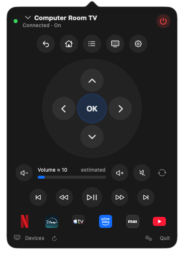
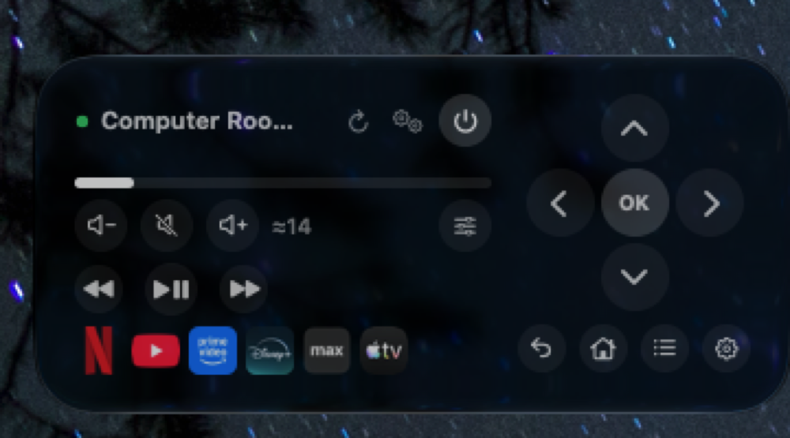
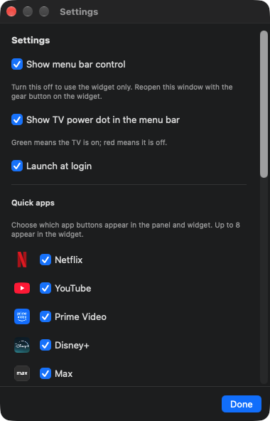

# MacDroid TV for macOS


A native SwiftUI menu bar app and interactive desktop widget for Google TV / Android TV.

> **AI-built:** This project was developed with substantial AI assistance — the
> code, UI, tests, and documentation were produced with DeepSeek V4.1 Flash
> running in OpenCode. Review the code before relying on it for anything
> sensitive.

**[Download the latest release →](https://github.com/frankt2012/MacDroidTV/releases/latest)**

- Menu bar popover with a full remote: D-pad, OK, back, home, menu, TV, settings,
  volume, mute, power, media transport keys, and a keyboard for typing directly
  into TV search/text fields.
- Small and medium widgets with a working D-pad, volume, mute, power, and live
  power/volume status. Each widget can be configured to control a different
  paired TV.
- Auto-refreshes while the TV is off, so turning it on with its own remote updates
  the app and widget automatically.
- Checks GitHub releases for updates from Settings, with an optional daily
  download-and-install mode.
- Direct implementation of the Google TV Remote protocol v2 (TLS + protobuf),
  with no Python or ADB dependency.
- Pairing certificate and TV list are shared between the app and widget through
  a macOS App Group container.

## Screenshots

<p align="center">
  
  
</p>
<p align="center">
  
</p>

## Requirements

- macOS 14 Sonoma or later
- Xcode 16 or later (Swift 5.9)
- [XcodeGen](https://github.com/yonaskolb/XcodeGen) (`brew install xcodegen`)

## Homebrew

```sh
brew tap frankt2012/macdroidtv
brew install --cask macdroidtv
```

The cask is in [frankt2012/homebrew-macdroidtv](https://github.com/frankt2012/homebrew-macdroidtv). This is a custom tap; the app is not yet in the official Homebrew Cask catalog.

## Build and install

```sh
cd GoogleTVRemote
xcodegen generate
xcodebuild \
  -project GoogleTVRemote.xcodeproj \
  -scheme GoogleTVRemote \
  -configuration Debug \
  -derivedDataPath build \
  -allowProvisioningUpdates \
  build
```

The app is a menu bar-only app (`LSUIElement`), so it does not appear in the Dock.

To install it for normal use:

```sh
rm -rf "$HOME/Applications/MacDroid TV.app"
ditto "build/Build/Products/Debug/MacDroid TV.app" "$HOME/Applications/MacDroid TV.app"
open -a "$HOME/Applications/MacDroid TV.app"
```

Then open the menu bar icon and pair a TV. To add the widget, open Notification
Center (or right-click the desktop and choose **Edit Widgets**) and add
**MacDroid TV**. The widget reads the app's shared state, so pair at least
one TV first.

## Signing and the App Group

The project uses automatic signing with the team in `project.yml`
(`DEVELOPMENT_TEAM`). Change that value to your own team if you fork this.

macOS has one important difference from iOS: **App Group identifiers must start
with the team identifier.** This project uses:

```text
BJB8XCZ8X9.group.com.franktriolo.googletvremote
```

A bare `group.com.…` identifier still makes
`containerURL(forSecurityApplicationGroupIdentifier:)` return a path, but every
write is then rejected by the sandbox with “You don't have permission to save
the file…”. If you change teams, update the identifier in all of these places:

- `GoogleTVRemote/GoogleTVRemote.entitlements`
- `TVRemoteWidget/TVRemoteWidget.entitlements`
- `Packages/TVRemoteKit/Sources/TVRemoteKit/Storage/SharedStore.swift`
- `project.yml` (`DEVELOPMENT_TEAM`)

If your signing setup rejects the entitlement, enable the App Group capability
for both bundle identifiers in the Apple Developer portal; Xcode's automatic
signing then creates the necessary profile when you build with
`-allowProvisioningUpdates`. A local development build with the team-prefixed
identifier works without an embedded profile in this project.

## Local network permission

The first time the app discovers or connects to a TV, macOS asks for local
network access. Allow it. Both the app and widget declare
`NSLocalNetworkUsageDescription` and browse `_androidtvremote2._tcp`; if access
is denied, discovery and commands fail even though pairing data is intact.

## Wake-on-LAN and networked standby

The power button can only turn on a TV that stays reachable on the network while it is off. Many TVs drop off Wi-Fi/Ethernet in standby unless a quick-start or networked-standby option is enabled. The app's **Devices → How to keep the TV reachable in standby…** guide covers this in-app.

Typical setting names by brand (menus vary by model and year):

| Brand | Setting |
|---|---|
| **TCL Google TV** | Settings → System → Power and energy → **Quick start** (On). If present, also Settings → Network & Internet → **Network Standby**. |
| **Sony Bravia** | Settings → Network & Internet → **Remote start** → On (Networked Standby) or On (powered by apps). Some 2020 models also need Home Network → IP control → **Simple IP control**. |
| **Hisense Google TV** | Settings → System → Power & Energy → **Fast Power On** or **Quick Start** (On), plus **Network Standby** if present. |
| **Philips** | Settings → Network → **Wake on LAN** / **WoWLAN** (On). Some models only support WoWLAN over Wi-Fi. |
| **Sharp Android TV** | Settings → Device Preferences → **Quick Start** (On), plus **Network Standby** if present. |
| **Xiaomi / Mi Box** | Settings → Device Preferences / System → Power → **Wake on LAN** or **Networked standby** (On). |
| **NVIDIA Shield** | Settings → Device Preferences → Power → **Wake on LAN** (On), or Developer options → **Stay awake**. |
| **Chromecast / Google TV Streamer** | Settings → System → Power → **Fast boot** / **Always on** if available; use the supplied power adapter. |

Tips:
- Ethernet is more reliable than Wi-Fi for standby networking.
- Give the TV a DHCP reservation so its address does not change.
- Add the TV's Wake-on-LAN MAC in the app's Devices window.
- Some TVs still leave the network in standby; those can only be switched on with their own remote.

## How pairing works

1. The app creates a self-signed RSA-2048 client certificate on first use. The
   certificate and private key are stored in the shared state file.
2. It connects to the TV on port **6467** over TLS and sends a pairing request.
3. The TV displays a six-character code. Enter it in the app.
4. The pairing secret is derived from the client and server RSA moduli and the
   code; the TV verifies it and the certificate is remembered.
5. Commands use port **6466**. The app answers the TV's `RemoteConfigure` /
   `RemoteSetActive` handshake and then injects key events.

The TV list, active device, cached power/volume state, and identity live in
`state.json` inside the App Group container. The widget never reads the private
key for display; it only uses it when sending a command.

## Project layout

```text
GoogleTVRemote/                 Menu bar app (SwiftUI, AppModel, views)
TVRemoteWidget/                 WidgetKit extension
Packages/TVRemoteKit/           Shared protocol, crypto, storage, intents
  Sources/TVRemoteKit/
    Crypto/                     RSA key generation, DER/X.509, pairing secret
    Intents/                    Widget App Intents
    Model/                      Shared Codable models
    Proto/                      Hand-rolled protobuf encode/decode
    Protocol/                   TLS framing, pairing, command connection
    Storage/                    App Group JSON store
  Tests/TVRemoteKitTests/       45 unit tests
project.yml                     XcodeGen project definition
```

## Diagnostics

The app binary has several terminal flags that are useful when the UI cannot show
what is happening:

```sh
APP="$HOME/Applications/MacDroid TV.app/Contents/MacOS/MacDroid TV"

"$APP" --diagnose      # container path, device count, cached state, debug log tail
"$APP" --write-test    # writes and reads back a marker, then restores state
"$APP" --reset-state   # deletes the shared state file
"$APP" --volume-probe  # sends volume up/down/mute and logs every protocol frame
"$APP" --discover      # browses Bonjour for TVs and prints their addresses
"$APP" --wol-test MAC  # sends a Wake-on-LAN magic packet to a MAC
open -a "$HOME/Applications/MacDroid TV.app" \
  --args --key-test volumeUp volumeDown  # sends keys through the app itself
```

`--diagnose` deliberately does not print the state file, because it contains the
pairing private key.

`--volume-probe` changes the TV volume briefly (three up, three down, mute
twice), so the net effect is zero. Because macOS ties local-network permission to
the app bundle, run it through LaunchServices rather than from a shell if the
terminal-launched process cannot reach the TV:

```sh
open -a "$HOME/Applications/MacDroid TV.app" --args --volume-probe
# then wait for it to finish and inspect the tail:
"$APP" --diagnose
```

`--key-test` is Debug-only. It sends the named keys through the same code path as
the buttons, which makes it possible to check the cached volume without clicking.

## Tests

```sh
cd Packages/TVRemoteKit
swift test
```

The tests cover protobuf round-trips, key-injection bytes, certificate
generation, identity recreation, pairing-secret derivation, and the local volume
estimate.

## Status and limitations

- Built and unit-tested against a physical TCL Google TV for pairing, power,
  navigation, and volume keys.
- **Some TVs do not report their volume over this protocol.** The TCL used for
  development answers `RemoteSetVolumeLevel` with `volume_max = 0` and
  `volume_level = 0` on every volume change, so the actual speaker volume cannot
  be read. The app ignores that 0/0 report and falls back to a local estimate
  that moves with the volume keys; it is labelled `≈` and `estimated` in the UI.
  TVs that do report a real scale show the exact level instead.
- **Powering on a TV in standby depends on the TV keeping its network alive.**
  With Ethernet and the TV's "always connected"/networked standby setting on,
  the TCL used for development stays reachable (mDNS, port 6466) while off, so
  the app can wake it. The power button sends a Wake-on-LAN magic packet (MAC
  set per device in the Devices sheet) and waits for the TV to announce itself;
  if it does, no power key is sent, because that key would toggle the TV
  straight back into standby. When WoL is not available or does not work, the
  power key itself wakes the TV. A TV that drops off the network entirely in
  standby can only be switched on with its own remote.
- The widget's App Intent buttons require macOS 14+ and a signed build; they do
  not work in Xcode Previews.
- This is a personal-use project, not an App Store submission. Hardened runtime
  is disabled and the app is signed for local development.

## License

MIT — see [LICENSE](LICENSE).
